# Inter-VLAN Routing with a Router (One Interface per VLAN)


A Cisco Packet Tracer lab where I split one switch into two VLANs and used a router to route traffic between them. I wrote down every step, including the mistakes I made and how I fixed them, because troubleshooting is where I learned the most.

> **Design used:** "legacy" inter-VLAN routing. Each VLAN gets its own physical router interface and its own access port on the switch. Every route is **directly connected**, so this lab doesn't need any static routes.

---

## Table of Contents

1. [Topology](#topology)
2. [Addressing Plan](#addressing-plan)
3. [Step 1 – Planning the Network](#step-1--planning-the-network)
4. [Step 2 – Base Configuration](#step-2--base-configuration)
5. [Step 3 – VLANs and Access Ports](#step-3--vlans-and-access-ports)
6. [Step 4 – Router Base Configuration](#step-4--router-base-configuration)
7. [Step 5 – Router Interfaces (Default Gateways)](#step-5--router-interfaces-default-gateways)
8. [Step 6 – Testing and Troubleshooting](#step-6--testing-and-troubleshooting)
9. [Verification](#verification)
10. [Key Takeaways](#key-takeaways)
11. [Next Steps](#next-steps)
12. [Final Configurations](#final-configurations)

---

## Topology

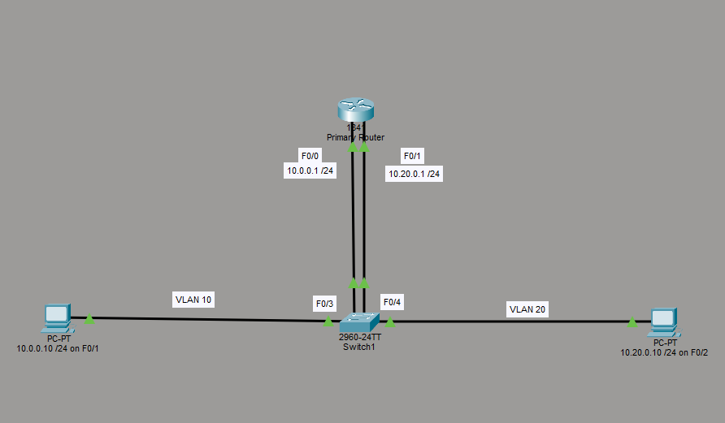

*The finished topology in Packet Tracer: every link is up (green).*

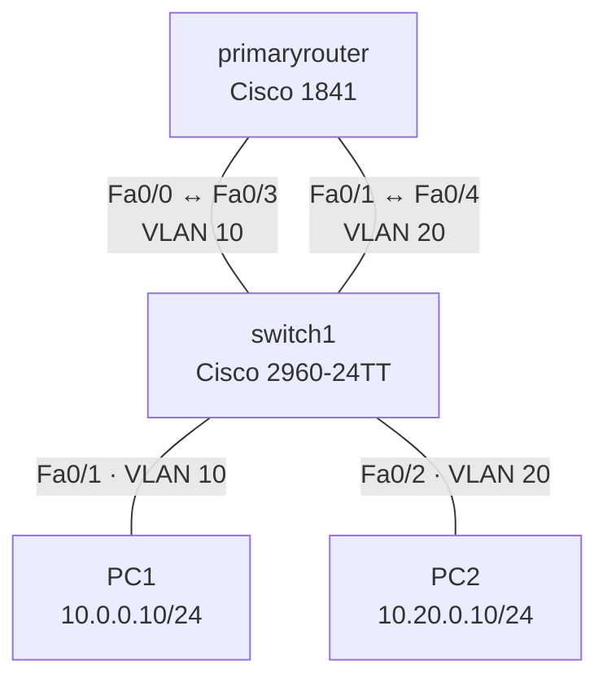

## Addressing Plan

| Device | Interface | IP Address | Subnet Mask | Default Gateway | VLAN |
|---|---|---|---|---|---|
| primaryrouter | Fa0/0 | 10.0.0.1 | 255.255.255.0 | — | 10 |
| primaryrouter | Fa0/1 | 10.20.0.1 | 255.255.255.0 | — | 20 |
| switch1 | VLAN 10 (SVI) | 10.0.0.2 | 255.255.255.0 | 10.0.0.1 | 10 |
| switch1 | VLAN 20 (SVI) | 10.20.0.2 | 255.255.255.0 | 10.0.0.1 | 20 |
| PC1 | NIC | 10.0.0.10 | 255.255.255.0 | 10.0.0.1 | 10 |
| PC2 | NIC | 10.20.0.10 | 255.255.255.0 | 10.20.0.1 | 20 |

### Switch Port Assignments

| Switch Port | Mode | VLAN | Connected To |
|---|---|---|---|
| Fa0/1 | Access | 10 | PC1 |
| Fa0/2 | Access | 20 | PC2 |
| Fa0/3 | Access | 10 | primaryrouter Fa0/0 |
| Fa0/4 | Access | 20 | primaryrouter Fa0/1 |
| Fa0/5 – Fa0/24 | Access (shut down) | 30 (unused) | — |
| Gi0/1 – Gi0/2 | Shut down | — | — |

---

## Step 1 – Planning the Network

Before I configure anything, I map out every device, its IP address, and the port it connects to. That way I know what goes where, and I have something to check against when I test later.

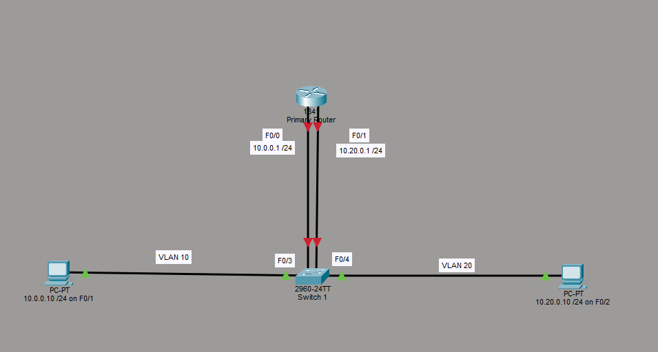

*The red link indicators on the router links mean those ports are down. The router interfaces haven't been configured or brought up yet.*

---

## Step 2 – Base Configuration

I put the same base configuration on every switch and router before I start on VLANs, routing, OSPF, and so on. I could paste a saved config, but I type it out every time to practice the commands.

### Getting into configuration mode

| Command | Mode you end up in | Purpose |
|---|---|---|
| `enable` (`en`) | Privileged EXEC (`Switch#`) | Gives access to every `show`, `debug`, `copy`, and `reload` command, and is required before entering configuration mode |
| `configure terminal` (`conf t`) | Global configuration (`Switch(config)#`) | Where configuration changes are made |
| `?` | Any | Lists the commands available in the current mode |

### Switch base configuration

```cisco
enable
configure terminal
hostname switch1
enable secret <password>
username admin secret <password>
ip domain-name marksnetwork.local
crypto key generate rsa general-keys modulus 1024
ip ssh version 2
!
line con 0
 logging synchronous
 login local
line vty 0 15
 logging synchronous
 login local
 transport input ssh
end
copy running-config startup-config
```

### What the less obvious commands do

| Command | What it does |
|---|---|
| `enable secret <password>` | Sets the password for privileged EXEC mode and stores it as a **hash** (type 5 / MD5), not as plain text |
| `username admin secret <password>` | Creates a local user account. `login local` makes the console and VTY lines ask for this username and password. |
| `ip domain-name marksnetwork.local` | IOS needs a **hostname and a domain name** to generate the RSA keys that SSH uses |
| `crypto key generate rsa ... modulus 2048` | Generates the RSA key pair. SSH stays disabled until this is done. SSH version 2 needs a modulus of at least 768 bits. |
| `ip ssh version 2` | Allows only SSHv2. SSHv1 has known weaknesses. |
| `line vty 0 15` | The virtual terminal lines used for remote access. Lines 0–15 allow up to 16 sessions at once (lines 0–4 would allow 5, because numbering starts at 0). |
| `logging synchronous` | Stops log messages from interrupting a command while you type it |
| `transport input ssh` | Allows only SSH on these lines and blocks Telnet, which sends everything, including passwords, in clear text |

> 💡 Configure **every** VTY line the same way. If some lines are left with different settings, remote access behaves inconsistently depending on which line a session lands on.

---

## Step 3 – VLANs and Access Ports

### VLAN 10

I made **Fa0/1** (PC1) and **Fa0/3** (the link to the router's Fa0/0) access ports in VLAN 10. Anything plugged into those ports is automatically in VLAN 10.

```cisco
interface FastEthernet0/1
 switchport mode access
 switchport access vlan 10
 switchport nonegotiate
 spanning-tree portfast
!
interface FastEthernet0/3
 switchport mode access
 switchport access vlan 10
 switchport nonegotiate
 spanning-tree portfast
```

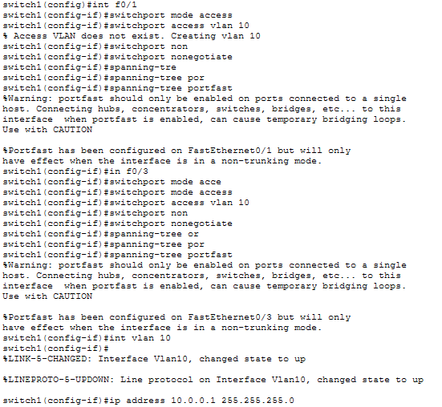

*IOS creates VLAN 10 automatically ("Access VLAN does not exist. Creating vlan 10"). The portfast warning is normal for edge ports. Notice the last line: I gave the VLAN 10 SVI the address `10.0.0.1`, which is the router's gateway address. That causes Bump #2 later.*

| Command | What it does |
|---|---|
| `switchport mode access` | Locks the port into access mode so it carries one VLAN, untagged, and never becomes a trunk |
| `switchport access vlan 10` | Puts the port in VLAN 10. Untagged frames that arrive on the port belong to VLAN 10. If VLAN 10 doesn't exist yet, IOS creates it automatically. |
| `switchport nonegotiate` | Turns off DTP (Dynamic Trunking Protocol) so nothing on the other end can negotiate a trunk. This is one of the main defenses against switch-spoofing VLAN-hopping attacks. |
| `spanning-tree portfast` | Moves the port straight to forwarding instead of waiting about 30 seconds in the listening and learning states. Use it only on ports that connect to end devices or a router, never to another switch. |

### VLAN 20 and unused ports

VLAN 20 is the same process with **Fa0/2** (PC2) and **Fa0/4** (the link to the router's Fa0/1). For the unused ports, I configured all of them in one go with `interface range`, moved them into a separate unused VLAN (30), and shut them down:

```cisco
interface range FastEthernet0/2, FastEthernet0/4
 switchport mode access
 switchport access vlan 20
 switchport nonegotiate
 spanning-tree portfast
!
vlan 30
 name UNUSED
!
interface range FastEthernet0/5 - 24
 switchport mode access
 switchport access vlan 30
 switchport nonegotiate
 shutdown
!
interface range GigabitEthernet0/1 - 2
 shutdown
```

**Why move unused ports out of VLAN 1?** Every port is in VLAN 1 by default, and VLAN 1 is the default native VLAN on trunks. If someone plugs into a forgotten port that's still in VLAN 1, they're on the same network as anything else left in VLAN 1. Moving unused ports into an isolated "parking" VLAN and shutting them down means:

- a device plugged into a spare port gets no link at all, and
- even if someone re-enables the port, it's stuck in a VLAN that leads nowhere.

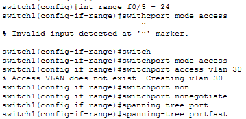

*Configuring Fa0/5–24 together with `interface range`. A typo (`swithcport`) gets the `% Invalid input` marker. The `^` points to where IOS stopped understanding the command.*

The finished access-port configuration from `show running-config`:

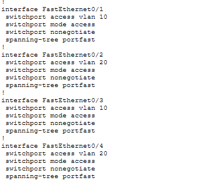

---

## Step 4 – Router Base Configuration

The router gets nearly the same base config as the switch: hostname, `enable secret`, local user, domain name, RSA keys, SSHv2, and the console and VTY line settings.

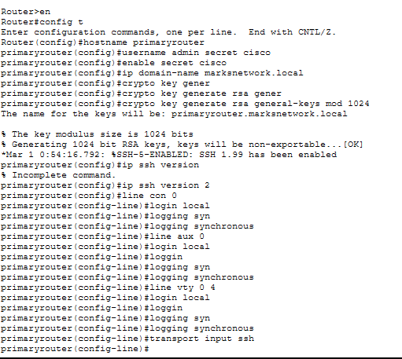

*After the RSA keys are generated, IOS reports "SSH 1.99 has been enabled", meaning it accepts both SSHv1 and SSHv2. `ip ssh version 2` then restricts it to v2 only.*

> 🔒 `cisco` is a lab-only password. Never reuse it, or any password shown in a screenshot, on real equipment.

---

## Step 5 – Router Interfaces (Default Gateways)

Each router interface becomes the **default gateway** for one VLAN:

```cisco
interface FastEthernet0/0
 description Gateway for VLAN 10
 ip address 10.0.0.1 255.255.255.0
 no shutdown
!
interface FastEthernet0/1
 description Gateway for VLAN 20
 ip address 10.20.0.1 255.255.255.0
 no shutdown
```

> ⚠️ **Bump #1:** I forgot that router interfaces are **administratively down by default**, unlike switch ports. Nothing worked until I ran `no shutdown` on each interface.

Once both interfaces are up, the router automatically adds both subnets to its routing table as **directly connected** (`C`) routes. That's all it needs to route between them, so no static routes are required.

---

## Step 6 – Testing and Troubleshooting

### Bump #2: I could only ping the default gateway

Each PC could ping its own default gateway, but nothing on the other VLAN.

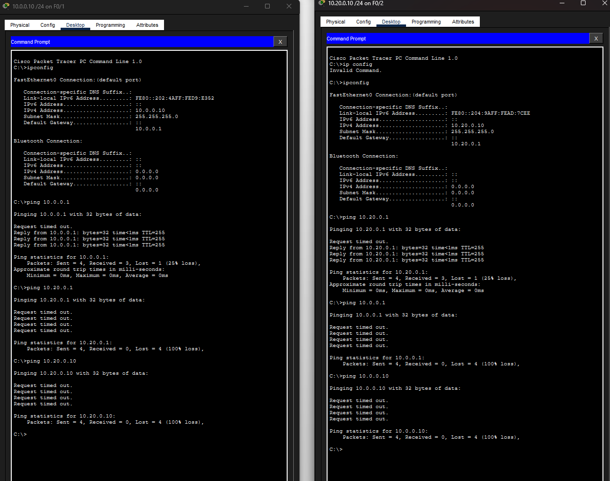

*Left: PC1 (VLAN 10). Right: PC2 (VLAN 20). Each PC gets replies from "its gateway", but can't reach the router's other interface or the other PC.*

Looking back, this was a clue. The router was cut off (see Problem A), so those gateway replies were **not coming from the router at all**. They came from the switch's own VLAN interfaces, which had the same IP addresses (see Problem B).

I found two problems in my configuration:

#### Problem A – The router-facing switch ports were trunks

I had originally set **Fa0/3** and **Fa0/4** to `switchport mode trunk` (allowing VLANs 10 and 20):

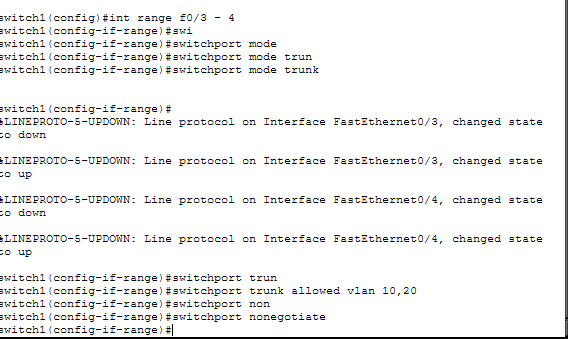

 But each router interface is a plain interface with no 802.1Q subinterfaces, so it sends and expects **untagged** frames.

On a trunk, untagged frames go into the **native VLAN (VLAN 1)**, not VLAN 10 or 20. And because VLAN 1 wasn't in the trunk's allowed list, those frames were dropped completely.

**Fix:** make each router-facing port an **access port** in the matching VLAN (Fa0/3 → VLAN 10, Fa0/4 → VLAN 20).

> Trunks with 802.1Q tagging are used in **router-on-a-stick**, where a single router link carries every VLAN on subinterfaces. My design uses one physical link per VLAN, so access ports are correct here. I had mixed the two designs.

#### Problem B – The switch reused the gateway IP addresses

I had given the switch's VLAN interfaces (SVIs) the **same IP addresses as the router**:

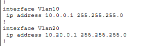

When a PC sent an ARP request for its gateway, **the switch could answer instead of the router**. The 2960 is a Layer 2 switch and doesn't route between VLANs, so the traffic stopped there.

**Fix:** give each SVI its own unique address. On a Layer 2 switch, SVIs are only for **managing the switch** (for example, SSH), never for acting as a gateway.

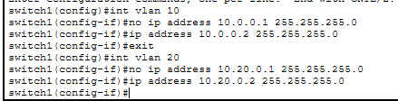

The switch keeps `ip default-gateway 10.0.0.1` so it can be managed from other subnets.

### ✅ Result

PC1 and PC2 can now ping their gateways, the router's other interface, and each other across VLANs.

**PC1 (10.0.0.10) → PC2:**

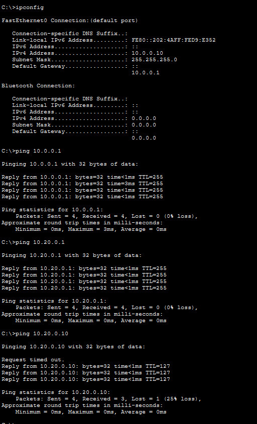

**PC2 (10.20.0.10) → PC1:**

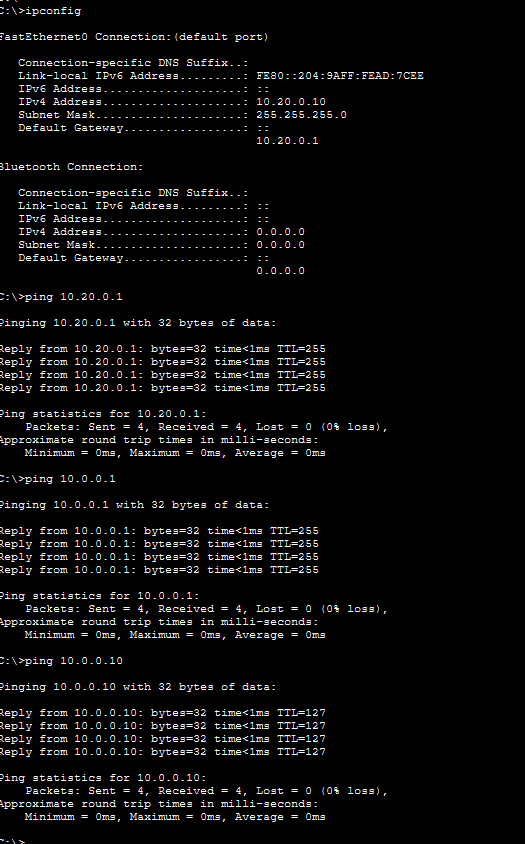

Two details worth noticing:

- **TTL=255 vs TTL=127.** Replies from the router's interfaces arrive with TTL 255 (Cisco's default). Replies from the other PC arrive with TTL 127: the PC starts at 128, and the router subtracts 1. That proves the traffic was **routed**.
- **The first ping timed out.** That's normal on a first attempt. The PC and router have to resolve MAC addresses with ARP before the first packet can be forwarded.

---

## Verification

Besides the pings above, these commands are useful for checking a setup like this. The output below is what a working configuration should look like:

**Switch: VLAN membership**
```
switch1# show vlan brief

VLAN Name                             Status    Ports
---- -------------------------------- --------- -------------------------------
1    default                          active    Gig0/1, Gig0/2
10   VLAN0010                         active    Fa0/1, Fa0/3
20   VLAN0020                         active    Fa0/2, Fa0/4
30   UNUSED                           active    Fa0/5, Fa0/6, ... Fa0/24
```

**Router: interface status and routing table**
```
primaryrouter# show ip interface brief
Interface          IP-Address   OK? Method Status  Protocol
FastEthernet0/0    10.0.0.1     YES manual up      up
FastEthernet0/1    10.20.0.1    YES manual up      up

primaryrouter# show ip route
     10.0.0.0/24 is subnetted, 2 subnets
C       10.0.0.0 is directly connected, FastEthernet0/0
C       10.20.0.0 is directly connected, FastEthernet0/1
```

**PC1: end-to-end test**
```
C:\> ping 10.20.0.10
Reply from 10.20.0.10: bytes=32 time<1ms TTL=127

C:\> tracert 10.20.0.10
  1   0 ms   0 ms   0 ms   10.0.0.1
  2   0 ms   0 ms   0 ms   10.20.0.10
```

The **TTL of 127** (one less than the Windows default of 128) and the two `tracert` hops show the traffic went **through the router**.

### Troubleshooting order I'll use from now on

1. Ping your own default gateway, which tests Layer 2 within the VLAN.
2. Ping the router's other interface, which tests that the router is reachable and routing.
3. Ping the remote host, which tests the full path.
4. If a step fails, check `show vlan brief`, `show interfaces status`, `show ip interface brief`, and `show arp` / `arp -a`.

---

## Key Takeaways

- **A switch port facing a router's physical interface should be an access port** unless the router uses 802.1Q subinterfaces (router-on-a-stick).
- **Untagged frames on a trunk go into the native VLAN.** Remember this when a trunk "should" be working but isn't.
- **Every IP address must be unique.** A duplicate gateway address doesn't throw an obvious error. It quietly breaks ARP.
- **Router interfaces start shut down. Switch ports start up.**
- **Directly connected networks don't need static routes.** The router already knows them.
- **Harden unused ports:** use a separate VLAN, `nonegotiate`, and `shutdown`.

## Next Steps

- Rebuild this lab as **router-on-a-stick** (one trunk link, `encapsulation dot1q` subinterfaces).
- Rebuild it again with **Layer 3 switch SVIs** (`ip routing` on a multilayer switch).
- Move switch management to a dedicated **management VLAN** with a single SVI.
- Add a `banner motd`, `exec-timeout`, `login block-for`, and `service password-encryption`.
- Use stronger password hashing where supported: `enable algorithm-type scrypt secret <password>` (type 9).

---

## Final Configurations

- [primaryrouter.txt](configs/primaryrouter.txt): Cisco 1841 router
- [switch1.txt](configs/switch1.txt): Cisco 2960-24TT switch

> Password hashes are removed from the published configs.
